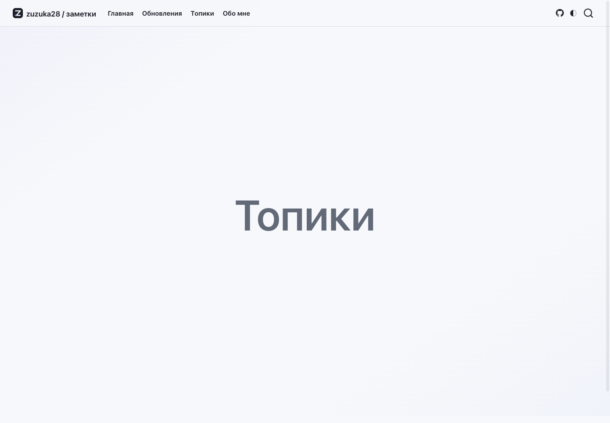
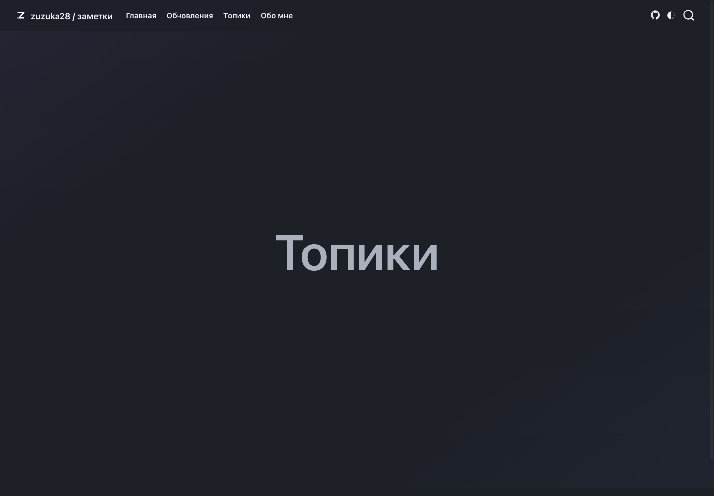

# Visual previews

Tracked screenshots are the current empty-site baseline. Refresh them after intentional layout or design changes:

```bash
make previews
```

The capture script uses a locally installed Chrome-compatible browser through the DevTools protocol and requires no npm packages. Set `CHROME_BIN` for a non-standard browser location.

## Landing


## Updates


## Topics





## About


